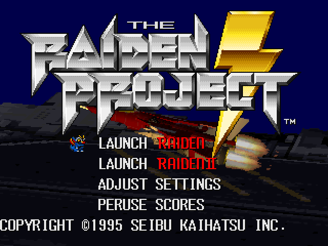
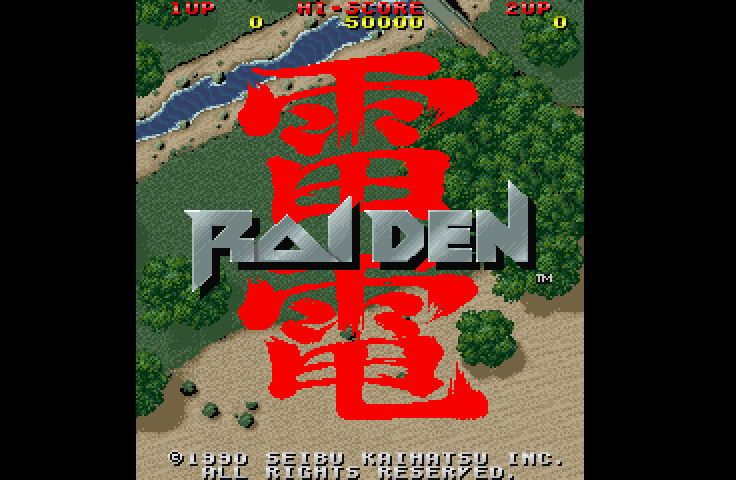
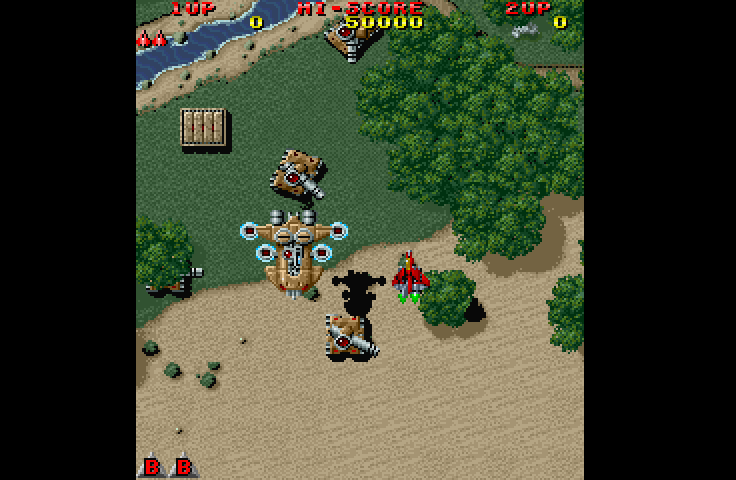
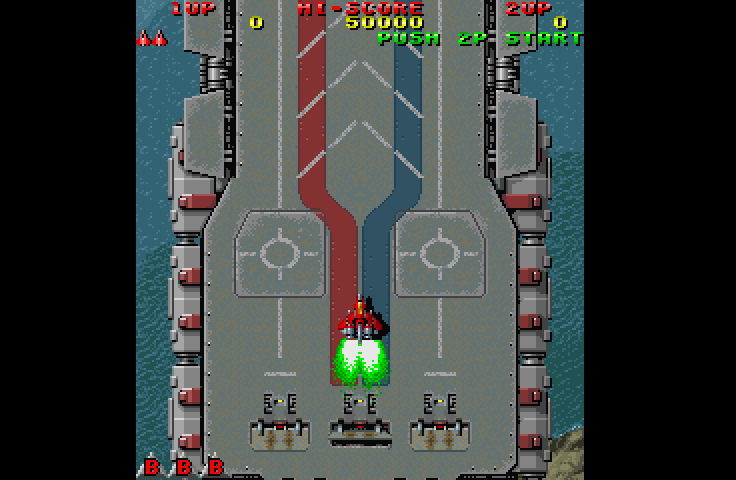
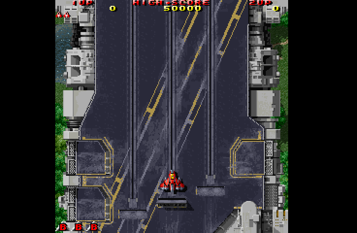
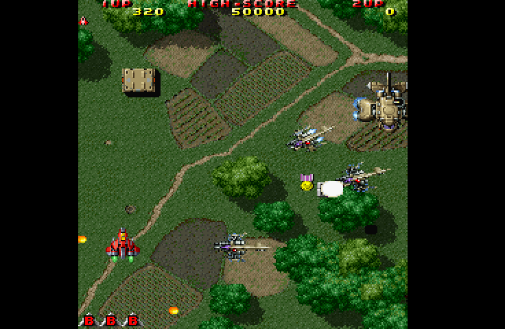
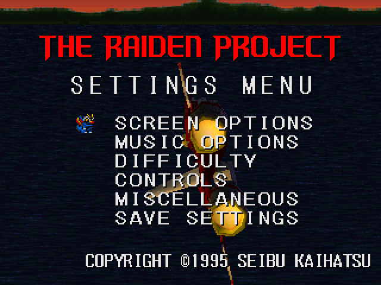
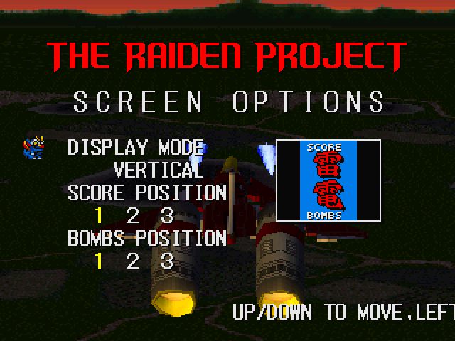
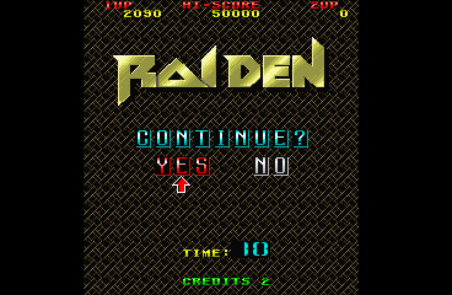

# The Raiden Project — native Linux port (static recompilation)

Play the PlayStation game **The Raiden Project** (USA, SCUS-94402) as a native Linux program.
The disc holds two Seibu Kaihatsu shooters — *Raiden* and *Raiden II* — behind one launcher menu,
and all of it runs.

The game's MIPS executables are translated into C by a static recompiler and compiled with gcc.
A small runtime written for this project stands in for the PlayStation hardware: graphics, sound,
CD, controller and BIOS. SDL2 provides the window, audio and input. No emulator or BIOS image is
needed.

> **No game files are included.** You need your own copy of the game. The build reads the
> executables from your disc image and generates the translated code locally.

| Launcher | Raiden | Raiden |
|:---:|:---:|:---:|
|  |  |  |
| **Raiden: carrier take-off** | **Raiden II** | **Raiden II** |
|  |  |  |
| **Settings** | **Screen options** | **Continue** |
|  |  |  |

## Requirements

- Linux x86-64
- `gcc`, `make`, `python3`
- SDL2 development files and zlib (Debian/Ubuntu: `sudo apt install build-essential libsdl2-dev zlib1g-dev`)
- Your own **The Raiden Project (USA)** disc image as `.bin` + `.cue` (MODE2/2352)

## Build

1. Clone the repository:

   ```bash
   git clone https://github.com/carlhako/raiden-project-recomp.git
   ```

   ```bash
   cd raiden-project-recomp
   ```

2. Copy your disc image into `disc/` (if it's zipped, unzip it there):

   ```bash
   mkdir -p disc
   ```

   ```bash
   cp "/path/to/Raiden Project, The (USA).bin" "/path/to/Raiden Project, The (USA).cue" disc/
   ```

3. Extract the executables, generate the C code and compile:

   ```bash
   make -j"$(nproc)"
   ```

   This pulls the files off the disc into `extracted/`, runs `tools/recomp.py` once per
   executable to write `gen/*.c`, and builds `./raiden`.

## Play

```bash
./raiden
```

The game streams its data from the disc image at runtime, so keep `disc/` and `extracted/` next
to the binary. Memory-card saves (settings and high scores) go to `memcard/bu00/`.

Pick **LAUNCH RAIDEN** or **LAUNCH RAIDENII** in the menu with up/down and ○. In game, **Start**
begins a game (credits are free) and **Select** opens the "interception menu" (resume, restart,
back to the main menu, switch to the other game, adjust display).

| PSX button | Keyboard | Gamepad |
|---|---|---|
| D-pad | Arrow keys | D-pad / left stick |
| Start | Enter | Start |
| Select | Backspace | Back |
| ✕ / ○ / □ / △ | Z / X / A / S | A / B / X / Y |
| L1 / R1 / L2 / R2 | Q / W / E / R | Shoulders / triggers |

Other keys: hold **Tab** to fast-forward, **F11** toggles fullscreen, **Esc** quits.
A second gamepad becomes player 2. Button assignments for fire and bombs can be changed in
the game's own **Adjust Settings → Controls** screen.

## How it works

- **Analysis:** [REA (Reverse Engineer Anything)](https://github.com/morluto/rea), with its Ghidra
  backend, produced the function inventory of each executable (`analysis/rea_*.txt`) and
  decompiled the pieces that needed understanding: the task launcher that switches stacks, the
  object update loops and the scripting VM (see [docs/TECHNICAL.md](docs/TECHNICAL.md)).
- **Translation:** `tools/recomp.py` turns about 283,000 MIPS instructions (5,300 functions) from the four executables
  into C. It handles delay slots, jump tables, indirect calls, interrupt checkpoints and `jr` used
  as a call with a hand-made return address.
- **Runtime:** `runtime/` contains the hardware emulation: software GPU, SPU, CD-ROM with XA
  audio, MDEC, GTE, DMA, timers, controller port and a high-level BIOS, including
  `Load`/`Exec`, which the launcher uses to start each game. Code the translator missed (such as
  the stage code that Raiden II loads from disc) falls back to a built-in interpreter.

See [docs/TECHNICAL.md](docs/TECHNICAL.md) for the full write-up and the debugging and testing
options (headless mode, scripted input, screenshots, WAV capture).

## Status

Tested in headless runs with scripted and randomised input (up to 40,000 frames per run) and
in a real window: launcher, settings, high-score screen, both games (Raiden in both display
modes), attract demos, play through the first stages, pause/interception menu, continue and
game over, memory-card save, music and sound effects.

Known limitations:

- Raiden II's per-stage code is loaded from disc into RAM at run time, so it runs in the built-in
  interpreter. Speed is still about 8× real time on one core.
- 1P vs 2P with two gamepads and the Raiden II ending have not been exercised.

## Legal

This project contains only original code and tools. It contains no copyrighted game data, no
generated game code and no BIOS. The Raiden Project © Seibu Kaihatsu / Sony Computer Entertainment
of America. Use your own legally obtained copy.
